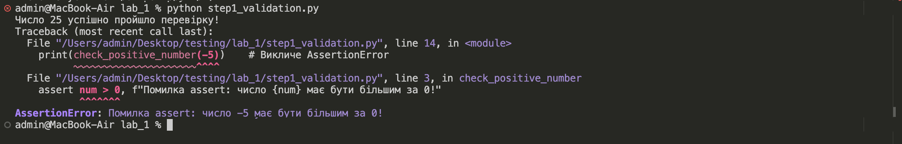
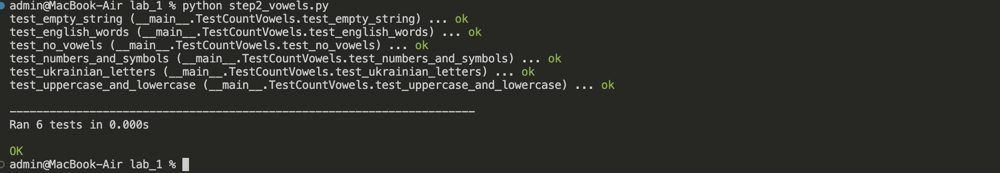
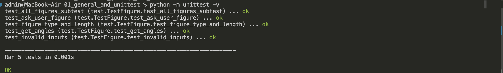

# Звіт до лабораторної роботи №07: Тестування програмного забезпечення (Загальне тестування та юніт-тести)

## 1. Мета роботи
Ознайомитися з базовими принципами тестування коду на Python: перевіркою даних за допомогою оператора `assert` та генерації винятків (`ValueError`), написанням модульних тестів із використанням стандартної бібліотеки `unittest`, параметризацією перевірок через `subTest` та імітацією зовнішніх залежностей (`input()`) за допомогою `unittest.mock`.

---

## 2. Налаштування середовища та команди запуску
Для ізоляції залежностей та запуску тестів використовувався менеджер проєктів [Poetry](https://python-poetry.org/) та стандартний модуль `unittest`.

### Основні команди, використані під час виконання роботи:
```bash
# Ініціалізація проєкту та встановлення залежностей
poetry init
poetry install

# Запуск скрипта перевірки введених даних (Крок 1)
python step1_validation.py

# Запуск юніт-тестів для функції підрахунку голосних (Крок 2)
python step2_vowels.py

# Запуск тестів для класу Figure з детальним виводом (Кроки 3–4)
python -m unittest -v
```
---
## 3. Результати тестів


